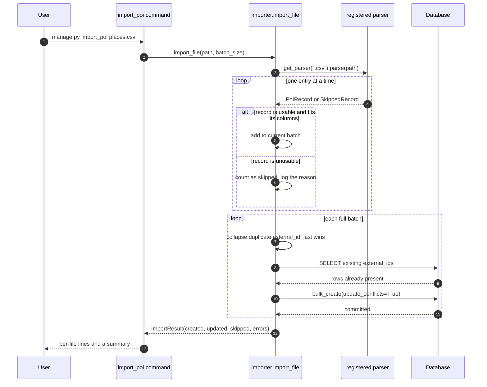
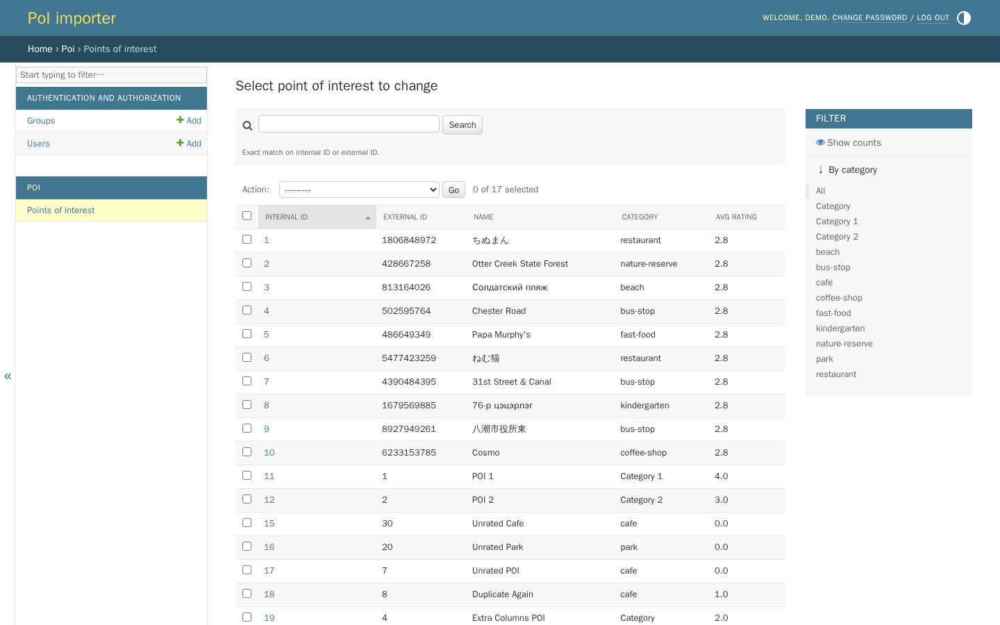
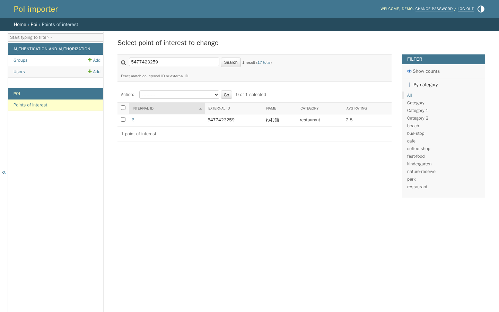
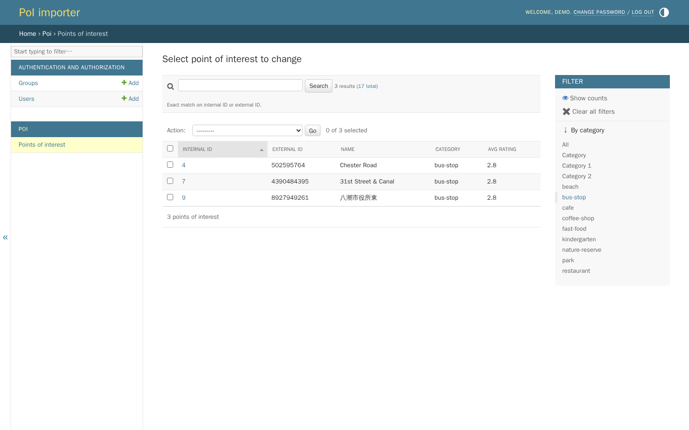
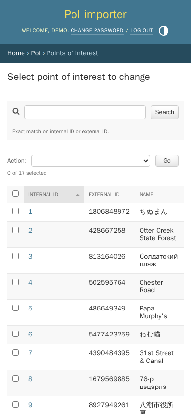

# PoI importer

A Django service that loads Point of Interest (PoI) records from CSV, JSON and
XML files and lets you browse them in the Django admin. One management command,
`import_poi`, gets data in. The admin is the only way to read it back; there is
no public HTTP API.

Every record keeps two identifiers: the `external_id` it carried in the source
file, and the `internal_id` this database assigns. The admin looks up either one
exactly (never as a substring) and filters the list by category.

The Django project package is called `SearchSmartly`; the app is `poi`.

## Run it with Docker Compose

The stack is RabbitMQ, the web app under gunicorn, and a Celery worker. Web and
worker share one SQLite file on a named volume, and both see the sample files
in `poi/test_files/` at `/import`.

```bash
cp .env.example .env
# In .env, set DJANGO_SECRET_KEY and RABBITMQ_PASSWORD to long random values,
# e.g. the output of `openssl rand -base64 48`.

docker compose up -d --build
docker compose exec web python manage.py createsuperuser
docker compose exec web python manage.py import_poi /import/dummy.csv /import/valid_data.json
```

Open <http://127.0.0.1:8890/admin/> (change the port with `WEB_PORT`) and go to
**Poi → Points of interest**.

The container runs with `DEBUG` off, so the session and CSRF cookies are marked
`Secure`. Chromium accepts them on `127.0.0.1` over plain HTTP (that is how the
screenshots below were taken). Behind a real hostname, put TLS in front and set
`DJANGO_ALLOWED_HOSTS` and `DJANGO_CSRF_TRUSTED_ORIGINS`.

To hand files to the worker instead of importing inside the web container:

```console
$ docker compose exec web python manage.py import_poi /import/edge_cases.json /import/edge_cases.xml --async
queued /import/edge_cases.json
queued /import/edge_cases.xml
Queued 2 file(s) for import.

$ docker compose logs worker
INFO poi.tasks /import/edge_cases.xml: 1 created, 0 updated, 1 skipped
INFO celery.app.trace Task poi.import_file[6b3ca3a7-59f5-4712-8ab3-5afeea981ee0] succeeded in 0.01365833399904659s: {'file_path': '/import/edge_cases.xml', 'created': 1, 'updated': 0, 'skipped': 1, 'errors': ["<POI> #2: field 'platitude' is not a number: 'not_a_float'"]}
INFO poi.tasks /import/edge_cases.json: 1 created, 0 updated, 2 skipped
```

`docker compose down -v` stops everything and deletes the database volume.

## Run it without Docker

Python 3.12 (see `.python-version`). Importing runs in-process and needs no
broker.

```bash
python3.12 -m venv .venv && source .venv/bin/activate
pip install -r requirements.txt

export DJANGO_DEBUG=1
python manage.py migrate
python manage.py createsuperuser

python manage.py import_poi poi/test_files/dummy.csv
python manage.py runserver
```

`DJANGO_DEBUG=1` is there only so you need not generate a key first. With
`DEBUG` off, startup refuses to continue until `DJANGO_SECRET_KEY` is set. For
`--async` locally, run a broker on `localhost:5672` and
`celery -A SearchSmartly worker --loglevel=info` in a second shell.

## Feeding it files

`import_poi` accepts any number of paths and picks a parser by extension
(`.csv`, `.json`, `.xml`):

| Format | Record | ID | Coordinates | Ratings |
| --- | --- | --- | --- | --- |
| CSV | one row | `poi_id` | `poi_latitude`, `poi_longitude` | `poi_ratings` as `{3.0,4.5}` |
| JSON | one object in a top-level array | `id` | `coordinates.latitude`, `coordinates.longitude` | `ratings` list |
| XML | each child of the root element | `pid` | `platitude`, `plongitude` | `pratings` as `3.0,4.5` |

Only the mean rating is stored. An empty ratings field means "not rated yet"
and stores `0.0`. Files may be UTF-8 with or without a byte-order mark, so
spreadsheet exports load as they are.

Two kinds of failure are treated differently:

- **One unusable record** is counted, logged and skipped, and the rest of the
  file still loads. That covers a missing or blank field, a non-number,
  `NaN` or infinity, a latitude outside ±90 or a longitude outside ±180, and
  text longer than its column (100 characters for the ID and category, 255
  for the name).
- **A problem with the file as a whole** (a missing column, malformed XML, a
  JSON document that is not an array) fails that file and the command exits
  non-zero, because importing part of a misunderstood file is worse than
  importing none of it.

Captured on a fresh database:

```console
$ python manage.py import_poi poi/test_files/dummy.csv poi/test_files/valid_data.json poi/test_files/valid_data.xml
poi/test_files/dummy.csv: 10 created, 0 updated, 0 skipped
poi/test_files/valid_data.json: 2 created, 0 updated, 0 skipped
poi/test_files/valid_data.xml: 0 created, 2 updated, 0 skipped
Imported 12 new and 2 updated PoI records, skipped 0.

$ python manage.py import_poi poi/test_files/edge_cases.json
WARNING poi.services.importer poi/test_files/edge_cases.json: item 1: missing or malformed 'coordinates' object
WARNING poi.services.importer poi/test_files/edge_cases.json: item 2: 'ratings' must be a list, got str
poi/test_files/edge_cases.json: 1 created, 0 updated, 2 skipped
Imported 1 new and 0 updated PoI records, skipped 2.
```

The XML sample reuses the JSON sample's IDs, which is why it shows as two
updates. Re-imports, both failure modes with their exit statuses and `--help`
are in [`docs/cli_session.txt`](docs/cli_session.txt).

## What one import does



A parser knows nothing about the database. It yields a `PoIRecord`, or a
`SkippedRecord` carrying the reason, and those failures travel *in the stream*
rather than as exceptions: a generator that raises is finished, so raising per
record would truncate an import at its first bad row.

`poi.services.importer` is the only module that knows about both a record and
the ORM, which is why the command, the Celery task and the tests all enter
through `import_file()` and cannot drift apart. It writes with
`bulk_create(update_conflicts=True)` keyed on `external_id`, so re-running an
import refreshes rows instead of duplicating them, and peak memory is bounded
by the batch size rather than by the file. It also checks text lengths against
the model's `max_length`: SQLite would store an over-long value, Postgres would
reject the whole batch, and the check makes both skip just that record.

Duplicates are collapsed per batch, last occurrence winning: one INSERT may not
name the same conflict target twice, and a file-wide `seen` set would grow with
the file. Per-batch and cross-batch resolution agree, so `--batch-size` does
not change the outcome.

## Browsing what you imported

The list shows both identifiers and the averaged rating, with the category
filter on the right. Rows cannot be added by hand: PoIs arrive only through
`import_poi`, which is why there is no **Add** button.



Searching an external ID returns exactly the one record that carries it, and
the category filter narrows the same list:




The stock admin layout collapses to one column on a phone:



### Why the ID search is exact

Django's default `search_fields` behaviour is `icontains`, which is the wrong
question to ask of an identifier: searching for `1` would also return
`1806848972`, `813164026` and every other ID that merely contains that digit.
`PointOfInterestAdmin.get_search_results` compares `external_id` exactly
instead, and compares `internal_id` only when the term is an ASCII integer a
`BigAutoField` could hold. An out-of-range number never reaches the database
(SQLite raises `OverflowError`, Postgres a range error), and a character such
as `²`, which `str.isdigit()` accepts but `int()` does not, no longer crashes
the page. `test_admin_search.py` pins this with an expectation table written
from the fixture rather than from the code, and drives the changelist through
the test client.

## Where the time goes

The bottleneck is writes, not parsing.
[`docs/benchmark_import.py`](docs/benchmark_import.py) implements a
row-at-a-time baseline alongside the batched importer and measures both, so the
comparison is reproducible: `python docs/benchmark_import.py 50000 200000`.
Captured output is in [`docs/benchmark_import.txt`](docs/benchmark_import.txt)
(Python 3.13.7, SQLite 3.53.4):

| Rows | Strategy | Time | INSERT statements | Peak Python memory |
| --- | --- | --- | --- | --- |
| 50,000 | per-row `objects.create` | 9.16 s | 50,000 | 0.3 MB |
| 50,000 | `bulk_create`, batch 500 | 3.50 s | 400 | 0.8 MB |
| 200,000 | per-row `objects.create` | 35.39 s | 200,000 | 0.1 MB |
| 200,000 | `bulk_create`, batch 500 | 14.45 s | 1,600 | 0.8 MB |

About 2.5x the throughput with 125x fewer INSERT statements. SQLite caps a
parameterised statement at 999 variables, so Django splits a 500-row batch into
4 statements at 6 columns per row. The win is far fewer round trips and
transactions, not one giant insert. `test_a_ten_row_file_is_one_insert_not_ten`
and its two siblings keep the statement counts from regressing.

XML is the other memory story. `ElementTree.parse` builds the whole document
before the first record is available; `iterparse` with a per-element `clear()`
does not:

| Rows | XML strategy | Time | Peak Python memory |
| --- | --- | --- | --- |
| 50,000 (10.4 MB) | `ElementTree.parse` | 0.58 s | 52.1 MB |
| 50,000 (10.4 MB) | `iterparse` + `clear` | 1.09 s | 0.2 MB |
| 200,000 (42.0 MB) | `ElementTree.parse` | 2.43 s | 208.0 MB |
| 200,000 (42.0 MB) | `iterparse` + `clear` | 4.37 s | 0.2 MB |

Streaming costs about 1.8x per element and holds a flat 0.2 MB instead of
roughly five times the document size, which is the right trade for a tool whose
whole job is large files.

Two indexes back the admin: `external_id` is unique and indexed for the lookup,
and a composite `(category, internal_id)` index serves the category filter in
the model's default ordering. That ordering is explicit because without one,
`LIMIT`/`OFFSET` paging is unstable and rows can repeat or vanish between pages
(`UnorderedObjectListWarning`). A test walks every page and asserts they
partition the table.

## Adding a file format

The parser registry is the one seam this project was most likely to need.
Write a class with an `extensions` tuple and a `parse()` method yielding
`PoIRecord` or `SkippedRecord`, then register it:

```python
from poi.parsers import register

register(MyGeoJsonParser())  # claims ".geojson"
```

Nothing in the importer, the command or the Celery task changes, and
`import_poi --help` lists supported extensions straight from the registry, so it
stays accurate on its own. `--async` checks the extension against the same
registry before queueing anything.

## Environment

Everything is read from the environment. Copy `.env.example` and adjust.

| Variable | Required | Default | Purpose |
| --- | --- | --- | --- |
| `DJANGO_SECRET_KEY` | Unless `DJANGO_DEBUG` is on | none | Signing key. Startup fails without it when `DEBUG` is off. |
| `DJANGO_DEBUG` | No | `0` | Debug mode. Off by default, so a missing env file cannot ship a debug server. |
| `DJANGO_ALLOWED_HOSTS` | No | `localhost,127.0.0.1,[::1]` | Hostnames Django will serve. Loopback rather than `*`. |
| `DJANGO_CSRF_TRUSTED_ORIGINS` | No | empty | Origins trusted for CSRF, needed behind a proxy. |
| `DJANGO_LOG_LEVEL` | No | `INFO` (`CRITICAL` under `manage.py test`) | Root log level. |
| `DJANGO_DB_ENGINE` / `_NAME` / `_USER` / `_PASSWORD` / `_HOST` / `_PORT` | No | SQLite at `<project>/db.sqlite3` | Database connection. Any Django backend. |
| `DJANGO_SECURE_SSL_REDIRECT` | No | `1` when `DEBUG` is off | Redirect HTTP to HTTPS. Set `0` when TLS terminates upstream. Compose sets `0`. |
| `DJANGO_HSTS_SECONDS` | No | `31536000` | HSTS max-age, applied only when `DEBUG` is off. |
| `DJANGO_HSTS_PRELOAD` | No | `0` | Off by default: preloading a domain is effectively irreversible. |
| `CELERY_BROKER_URL` | Only for `--async` | `amqp://localhost:5672//` | Celery broker. Compose builds it from the RabbitMQ variables. |
| `CELERY_RESULT_BACKEND` | No | empty | Celery result backend. |
| `CELERY_TASK_ALWAYS_EAGER` | No | `0` (`1` under `manage.py test`) | Run tasks inline instead of dispatching them. |
| `RABBITMQ_USER` / `RABBITMQ_PASSWORD` | Password, for Compose | `guest` / none | Broker account created by the RabbitMQ container. |
| `WEB_PORT` | No | `8890` | Host port Compose publishes the web app on (127.0.0.1 only). |

## Tests and lint

```bash
pip install -r requirements-dev.txt

python manage.py test poi     # 64 tests: parsers, importer, admin, CLI
ruff check .
ruff format --check .
```

`poi/tests/__init__.py` installs a process-wide socket guard that raises on any
outbound connection, so no test can pass merely because the machine running it
has connectivity. Celery runs eagerly under `manage.py test`, so no broker is
needed. Inside the Compose stack the same suite runs with
`docker compose exec web python manage.py test poi`.

## Known gaps

- **JSON is read whole.** `json.load` materialises the document before the
  first record is yielded, so peak memory scales with JSON file size while CSV
  and XML stream. The standard library has no incremental array reader, and a
  streaming JSON dependency was not worth it at these sizes.
- **No HTTP API.** The admin is the entire read interface: no endpoints, no
  serialisers.
- **Coordinates are plain floats.** No geospatial index and no proximity
  search. PostGIS and `django.contrib.gis` would be the route if "PoIs near
  me" were ever required.
- **Only the mean rating is stored**, not the individual ratings, so it cannot
  be recomputed or audited after import.
- **Duplicate resolution is last-one-wins**, within a file and across
  re-imports: no merge policy, no history.
- **SQLite is shared by web and worker** in Compose. That is fine for a demo
  and a single worker; concurrent imports at volume want Postgres
  (`DJANGO_DB_ENGINE=django.db.backends.postgresql` plus a `psycopg`
  install), which the settings accept but no service in the Compose file
  provides.
- **`--async` has no result backend by default**, so a queued import reports
  its outcome only to the worker's log unless `CELERY_RESULT_BACKEND` is set.

## License

MIT, see [`LICENSE`](LICENSE).
